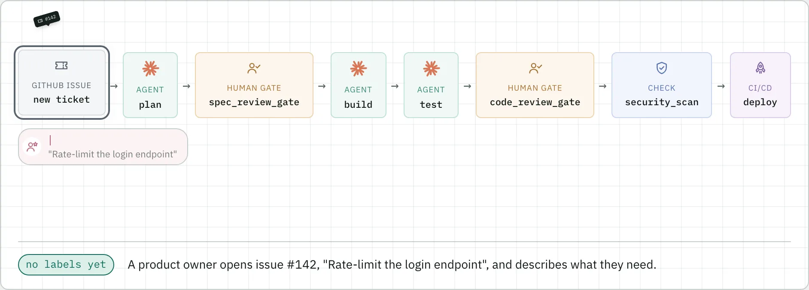

<div align="center">


# Run-Factorial

[](https://github.com/leaninnovationlabs/run-factorial/actions/workflows/tests.yml)
[](https://github.com/leaninnovationlabs/run-factorial/actions/workflows/lint.yml)
[](LICENSE)
[](https://www.python.org/)
[](ui/)
[](https://www.postgresql.org/)
[](https://gallery.ecr.aws/runfactorial/factorial)
<br>
[](https://docs.claude.com/en/docs/claude-code/overview)
[](https://github.com/openai/codex)
[](https://e2b.dev)
[](https://www.runfactorial.com)
[](https://www.runfactorial.com/docs)

**The assembly line for AI software delivery.**

[Website](https://www.runfactorial.com) ·
[Docs](https://www.runfactorial.com/docs) ·
[Quick setup](https://www.runfactorial.com/docs/run-the-public-image/) ·
[Design](docs/design.md)

<picture>
  <source media="(prefers-color-scheme: dark)" srcset="docs/diagrams/lane-dark.webp">
  
</picture>

Each step waits for evidence that the orchestrator checks itself.
[See it step by step](https://www.runfactorial.com/docs/process-lifecycle/#example-lane).

</div>

> [!NOTE]
> We build Run-Factorial in a private repository and publish its code here. This repository
> does not accept issues or pull requests. To report a security problem, follow
> [SECURITY.md](SECURITY.md). The documentation is at
> [runfactorial.com/docs](https://www.runfactorial.com/docs).

A person writes a request as a GitHub issue, adds the label `factorial:new`, and assigns an
owner. The ADLC orchestrator admits the ticket and walks it through the process that the
repository defines in `.factorial/processes/`. A repository can define more than one process,
and an issue names which one it enters. Each step runs an agent or waits at a human gate. An
agent writes its work on its own branch and opens its own pull request. A person approves at
each gate, and only a human review merges agent code to `main`.

The orchestrator runs a reconciliation loop for each active ticket: observe, evaluate,
act, project. It polls GitHub for the true state. A webhook is only a wake-up signal that
starts an immediate poll, so a lost webhook can never corrupt state. The state machine
lives in Postgres. Issue labels (`factorial:<step>`, `factorial:blocked`, `factorial:interrupted`,
`factorial:waiting`, `factorial:exit`, `factorial:done`) are a projection of that state, for
human visibility.
Postconditions gate each step: the orchestrator trusts predicates, never an agent's
self-report. There is one exception. A person can move a step past its postconditions
from the dashboard. The orchestrator records the name of that person, and the step does
not count as a success.

Three labels are different. Their removal does something. You stop a run from the
dashboard, and the orchestrator parks the ticket with `factorial:interrupted`. You remove
the label, and the agent continues its own session. Comments you leave in the meantime
become its next instruction. An agent that waits too long for an answer parks
with `factorial:waiting`, and its removal also continues the session. You send a ticket
away from the dashboard, with the `factorial:exit` label, or by closing the issue, and the
orchestrator parks it as exited. You reopen the issue if you closed it, remove the label,
and the ticket gets a fresh try at the step it left. An interrupted run continues where it
stopped instead.

Agents run through runtime adapters behind one contract. The `claude_cli` adapter
runs the `claude` CLI, and the `codex_cli` adapter runs the `codex` CLI. Each runs an
agent in a git worktree on the host, with no container.
The `claude_e2b` and `codex_e2b` adapters run the same CLIs in an E2B sandbox, one for each run. The
model credential and the GitHub token stay outside the sandbox. The one exception is a codex
subscription login, which is a file (decision 25). A process names
a runtime that an operator creates on the Runtimes page. That runtime holds the vendor
key and selects the host or a cloud sandbox (decision 36). A cloud sandbox runtime also holds
the key and the template of its E2B team, so each runtime can use a different E2B team.

The architecture and its numbered decisions live in [`docs/design.md`](docs/design.md).

## How an issue becomes merged code

The recording at the top of this page shows one ticket on the line.
The [Process lifecycle](https://www.runfactorial.com/docs/process-lifecycle/#example-lane)
page shows the same line step by step.

---

## How to set up the orchestrator

**You need:** Python 3.13, [uv](https://docs.astral.sh/uv/), Node 22.12+,
[pnpm](https://pnpm.io/) and Docker (started).

```bash
git clone https://github.com/leaninnovationlabs/run-factorial.git
cd run-factorial
```

```bash
uv sync                              # the Python workspace: orchestrator/ + runtime/
pnpm --dir ui install

cp .env.example .env                 # then fill it in
cp ui/.env.example ui/.env.local

make image                           # the image, which also holds the Postgres
make db                              # that Postgres alone, on 127.0.0.1:5432
uv run alembic upgrade head
```

`orchestrator.settings` reads everything from `.env`. The prefix is `FACTORIAL_`, and nested
keys use `__`. [`.env.example`](.env.example) documents every variable. Set these three
first:

| Variable | Notes |
|---|---|
| `FACTORIAL_API_TOKEN` | Shared secret for scripts and services that call the API. 32 characters or more: `openssl rand -base64 32` |
| `FACTORIAL_MASTER_KEY` | Base64, 32 bytes: `python -c "import base64,os; print(base64.b64encode(os.urandom(32)).decode())"` |
| `FACTORIAL_CORS_ORIGINS` | `http://localhost:5173`, so the dashboard can reach the API |

`ui/.env.local` holds one variable. `VITE_API_BASE_URL` is the origin of the API. The
dashboard adds `/factorial` to it. The API tells the dashboard the origin of the terminal
service. The dashboard does **not** use the API token. You sign in with an account. On a new
database, the first account that you make is the owner.

## How to run it

Three processes, each in its own terminal:

```bash
FACTORIAL_API_DOCS=true uv run uvicorn orchestrator.api.serve:app --reload   # API → http://localhost:8000/factorial
uv run python -m orchestrator.worker                 # reconciliation loop
pnpm --dir ui dev                                    # dashboard at http://localhost:5173/factorial/
```

`pnpm --dir ui dev` proxies `/factorial/auth` to the API so Google or Okta can return to port 5173.
`/api` still goes cross-origin to `VITE_API_BASE_URL`.

To watch or type into a run, start the terminal service in a fourth terminal:

```bash
uv run python -m orchestrator.terminal               # terminal at ws://localhost:8001
```

The service needs `FACTORIAL_TERMINAL__ENABLED=true`. This setting turns on the Terminal section
only. Each run is a session when the setting is on or off. The Terminal section works with the
API token or with a dashboard session.
A `claude_cli` or `codex_cli` run needs tmux 3.2 or later on the host, and the CLI version that
the adapter pins. For `codex_cli`, that is the native `codex` binary, not
the npm package.

The Makefile holds these commands as targets. Run `make help` for the list.

The dashboard has two views. **Projects** shows one repository at a time. A project opens on
its Dashboard page. The page shows what the project spent and what it delivered: spend by
outcome, by ticket and by step, and the tickets closed each week. Inside a project, the left
navigation shows the project name first. Click it to switch to a different active project.
Below the name, the navigation lists the pages of the project: the Dashboard, the Tickets, the
Assistant, and **Project settings**, with one page for each requirement. You can collapse the
list of Project settings pages. The Assistant opens at the right side of the page. The Project
settings overview lists every requirement with its state. The checks that read GitHub run when
you open the overview or the page of one of them. Press **Check repository** to run them again.

Outside a project, the left navigation shows **Overview**, **Projects** and **Assistant**. The
Assistant opens as a full page. Below them, the **Settings** group holds **Runtimes**, **MCP
access** and **Assistant settings**. The organization name is at the bottom of the left
navigation. Click it to switch to a different organization.

**Overview** shows the factory. It draws one square for each ticket, in a band for each
project, in a column for the state the ticket is in. Click a column, a project or a square to
select it. The buttons above the board color the squares by cost, by runtime, by tokens or by
retries.

The board keeps tickets that closed in the last 7 days. To change the period, add
`?done_days=` to `GET /api/orgs/<org>/overview`.

Test that it came up:

```bash
curl http://localhost:8000/factorial/healthz         # process is alive
curl http://localhost:8000/factorial/readyz          # and can reach Postgres
open http://localhost:8000/factorial/docs            # OpenAPI, with FACTORIAL_API_DOCS=true only
```

To point the orchestrator at a repository (project, secrets, config snapshot, labels and
activation), follow [`docs/bootstrap.md`](docs/bootstrap.md). The `.factorial/`
folder format has a commented reference at
[`docs/samples/factorial-simple/`](docs/samples/factorial-simple/).


## How to run it in one container

One Docker image holds the full app: Postgres, the API, the worker, the terminal service, the
assistant, tmux, and the `claude` and `codex` CLIs. The API also serves the dashboard. The
worker starts Claude and Codex agents in the container.
You build the image on your machine.
On your machine, `make up` starts the app container and a second container, `database`, for
the database. Both containers use the same image.

**You need:** Docker (started) and a `.env` file.

```bash
cp .env.example .env                 # then fill it in
make image                           # build factorial:local
make up                              # dashboard at http://localhost:8000/factorial/
docker compose logs -f app
```

Set `FACTORIAL_API_TOKEN` and `FACTORIAL_MASTER_KEY` in `.env`.
Also set `FACTORIAL_RUNTIME__E2B__DEPLOYMENT` to a name that no other copy of factorial uses.
The container does not start without it. The
container sets the database URL, the CORS origin and the agent folder.
It does not use the values for these in `.env`.

The container reads `.env` as a mounted file. Do not give it `.env` with `env_file:`, `--env-file`
or `-e`. Each agent gets the environment of the worker, and an agent must not get the master key.
The container also stops when an AWS credential is in its environment, for example
`AWS_ACCESS_KEY_ID`.

When a setting is missing, the container stops. `docker compose logs app` shows the setting to
fix. When all settings are correct, the container waits for the database, applies the
migrations, and then starts the API, the worker, the terminal service and the assistant.

The `codex_cli` runtime runs in the container when the container starts with the seccomp
profile `docker/seccomp.json`. `make up` applies it.

The `factorial-data` volume keeps the database and the agent runs:

```bash
make down                             # stop the containers; the data stays
docker volume rm factorial-data       # after make down: delete the data also
```

Use `make down`, not `docker rm -f`. The terminal service needs up to 45 seconds in all to
close its terminals. Do not use `docker compose down -v`.

`make dev` uses the same database: `make db` starts the `database` container alone. The
containers and `make dev` use the same ports, so run `make down` before `make dev`.

If you ran the one container of an older version, remove it one time before `make up`. The
volume and its data stay:

```bash
docker stop factorial && docker rm factorial
```

`make up` refuses to start while another container uses `factorial-data`. Two Postgres
servers on one volume corrupt the database.

[`docs/local-container.md`](docs/local-container.md) gives the same steps in full: each
setting to write, each setting the container sets itself, and what to do when it stops at
start.

## Checks

`make check` runs the checks that `main` needs: lint, types, the Python tests, and the
dashboard build and tests. It also runs the STE check on this file. CI runs the same checks on
each push to `main`.

---

## Security

Each project connects to GitHub on its Ticket source page, with a GitHub App or with a token.
Factorial keeps the private key, the webhook secret and the token encrypted in the `secret`
table. No deployment setting holds a GitHub credential.

With an App, the orchestrator mints a token for each run. The token is valid for one hour. It
gives access to named repositories only. The orchestrator mints each agent's token from its
manifest's `permissions:` block, under the project's permission ceiling
([`docs/design.md`](docs/design.md) §7). With a token, each run gets the stored token, which
does not expire. The page tells you what that costs before you choose it.

> **Do not put a GitHub key or token in `.env`.** The file holds no GitHub setting, and
> `*.pem` stays gitignored.

The App never gets `workflows: write`. CI runs agent code with repository secrets before
a person sees it, so an agent must not be able to edit its own gates
([`docs/design.md`](docs/design.md) §7.2).

A gate is the control that blocks a bad merge. The orchestrator merges a pull request only
when a person that the gate accepts approved its latest commit. This control does not depend
on the agent. A lane has one of two shapes. In a stacked lane, the implementation pull request
targets the `spec/<slug>` branch, and only the spec pull request goes to `main`. In a
base-target lane, both pull requests target `main`. Every starter lane is a base-target lane.

Branch protection on `main` is the second control. The Project settings pages report it, but
the orchestrator does not enforce it. The App authors every agent pull request, and GitHub does
not let an author approve its own pull request. On an App project, the App has no bypass
([`docs/design.md`](docs/design.md) §7.3).

### What Factorial does not build

| Item | Why |
|---|---|
| A loop that corrects its own failures | Tests written by an agent make the code fit the tests |
| An agent that holds a deploy credential | The design gives no agent a deploy credential, and no setting can change that |

---

## Where to read more

| Document | When you need it |
|---|---|
| [`docs/design.md`](docs/design.md) | The architecture and its numbered decisions |
| [`docs/data-model.md`](docs/data-model.md) | The Postgres tables and how they relate |
| [`docs/bootstrap.md`](docs/bootstrap.md) | Point the orchestrator at a repository; `.factorial/` authoring facts |
| [`docs/process-yaml.md`](docs/process-yaml.md) | The field reference for a process file, and the rules that apply to it |
| [`docs/enable-previews.md`](docs/enable-previews.md) | Enable and test app previews and the files a step shows, for a repository |
| [`docs/mcp.md`](docs/mcp.md) | Connect Claude Code or Codex to the orchestrator's MCP server |
| [`docs/setup.md`](docs/setup.md) | The GitHub App, the credentials, the machine |
| [`docs/writing-rules.md`](docs/writing-rules.md) | The documentation rules |
| [`docs/diagrams/`](docs/diagrams/) | The recordings of the example lane, one for each theme |
