# Factorial — Data Model

**Status:** v0.15 · 2026-11-05 · Postgres. DDL: Alembic revision 0001; the SQLAlchemy models are
the source of truth (tech-stack decision 2).

## Decisions (agreed 2026-08-19)

- Secrets: **app-encrypted in Postgres** (ciphertext + key id; plaintext never stored/logged).
- Config pinning: **snapshot the parsed config** into `process_version`, identified by the commit
  it was read from; a ticket pins one row at admission time.
- Agent definitions: **content in git, registry row in Postgres** (name → repo path + commit).
- **Several processes per project** (revision 0016), each a file under `.factorial/processes/`
  with its own `process_version` history keyed `(project_id, process_key, source_commit_sha)`
  (revision 0017), and by the repository it was read from as well since revision 0042. A ticket
  picks one at admission and keeps it. Revised from "one process per
  project", which the history had encoded as `(project_id, version)`.
- People in GitHub and Jira are logins stored as text. Dashboard accounts and roles came in v0.13.
- Artifact *content* lives in GitHub only; Postgres stores locator metadata.

## Decisions (added v0.2)

- `project.description` added; `project.github_repo` already covered "which repo" and is unchanged.
- Audit columns on every table, trigger-maintained, **except** `updated_at` on the append-only three.
- Project-level configuration goes in `project.settings` (JSONB), starting with `agent_runtime` and
  `app_runtime`; `agent.runtime_kind` becomes a nullable override of the project default.

## Decisions (added v0.5)

- Runtimes are **rows, not settings** (revision 0011): `runtime` is operator-owned state a repo's
  `process.yaml` may only *reference* by `slug` — the same trust direction as `mcp_allowlist`
  (design.md §7.5), the repo selects and Postgres defines. `project.settings.agent_runtime` was
  documented for this and never read; the table replaces that slot. Every process names one
  (tech-stack decision 70).
- Runtime credentials get their **own table**, `runtime_credential`, `secret`'s twin. Same
  envelope, different AAD namespace (`runtime:<id>:<name>` against the project's bare
  `<id>:<name>`): the two id sequences collide routinely and must never authenticate each other's
  blobs.

## Decisions (added v0.9)

- MCP tokens are **rows** (revision 0022). `mcp_token` is the authority for every request on
  `/mcp/`: the JWT's signature only finds the row (design.md §7.16). Rows are never deleted, and
  they are not events, because `event.project_id` is NOT NULL and a token belongs to no project.

## Decisions (added v0.10)

- The assistant's chat has its own tables (revision 0024): `app_setting`, `app_credential`,
  `chat_conversation`, `chat_turn`, `chat_item`, `chat_proposal`, `chat_backend_state` and
  `chat_spend`. A
  conversation is not an event, because `event.project_id` is NOT NULL and a conversation spans
  projects. A write the chat causes is still an event.
- A conversation is deleted 30 days after its last activity. The clock is
  `chat_conversation.updated_at`, which an item insert touches (the `chat_item_touch_conversation`
  trigger). The daily budget is kept apart, in `chat_spend`, so deleting a conversation does not
  give back what its turns spent.

## Decisions (added v0.11)

- An **organization** is the tenant root (revision 0027, design.md §2.11). It owns projects,
  runtimes, MCP tokens, assistant conversations, and the assistant's settings, credential and
  daily budget; everything a project owns is reached through `project_id`, so no other table
  gains a column. The migration seeds `default` and puts every existing row in it.
- `project.name` and `runtime.slug` are unique **per organization**, so a runtime slug resolves
  within the project's organization only.
- The assistant's settings move to `organization_setting`, and its credential to
  `organization_credential`. `app_setting` keeps only the assistant process's health.
  `app_credential` is dropped once its rows have moved: each value was bound to `app:<name>`,
  so the migration decrypts it with the master key and encrypts it again for `default`.
- `chat_spend` is keyed `(organization_id, owner, day)`: each organization sets its own budget, so
  spend in one never uses another's.

## Decisions (added v0.13)

- **Accounts, membership, roles and invites** (revision 0035, design.md §7.19, tech-stack.md
  decision 80): `app_user`, `organization_member`, `organization_invite`, `role`, `permission`
  and `role_permission`. No existing column changes. Every deployment fills them: the multi-org
  flag decides only whether anyone may sign up and create organizations.
- **Removals are remembered apart from membership** (revision 0036, design.md §7.19 item 13):
  removing a member still deletes the `organization_member` row, and `organization_removal`
  records the email so the allowed-domain SSO join does not add the person back. It is a
  separate table, not a soft delete: no membership query must remember to skip it.
- **Settings are the admin's, and the terminal is a permission** (revision 0037, design.md
  §7.19 item 5): `tickets:terminal` and `mcp_tokens:manage` join the catalogue, the owner and
  the admin hold both, and the admin now holds `org:manage`. Only rows change: no table or
  column does.
- A permission is a row for each key of the code's closed `Permission` enum; the built-in roles
  are `role` rows with no organization. The revision seeds both, and only a revision changes them.
- `organization.settings` is now validated by `OrganizationSettings` on read and on write.
- **A session can be revoked** (revision 0040, design.md §7.19): `app_user.session_epoch`,
  default 0. The session cookie was only signed, so a stolen one outlived its owner's sign-out.

## Decisions (added v0.15)

- **A process snapshot records the repository it was read from** (revision 0042, issue #441):
  `process_version.source_repo`, beside `source_commit_sha`, and part of the row's identity:
  `(project_id, source_repo, process_key, source_commit_sha)`. A sha names nothing without its
  repository, and every reader had joined it with the project's current `github_repo`, so
  changing the repository broke every synced version. Every pinned read now goes to the row's
  own pair. A version is offered only while its `source_repo` is the project's `github_repo`.
  The backfill copied each project's `github_repo`, which is wrong for a project whose
  repository had already changed: nothing recorded the earlier one.

## ER diagram

```mermaid
erDiagram
    ORGANIZATION ||--o{ PROJECT : "owns"
    ORGANIZATION ||--o{ RUNTIME : "owns"
    ORGANIZATION ||--o{ MCP_TOKEN : "scopes"
    ORGANIZATION ||--o{ CHAT_CONVERSATION : "scopes"
    ORGANIZATION ||--o{ ORGANIZATION_SETTING : "configures"
    ORGANIZATION ||--o{ ORGANIZATION_CREDENTIAL : "holds (encrypted)"
    ORGANIZATION ||--o{ CHAT_SPEND : "budgets"
    ORGANIZATION ||--o{ ORGANIZATION_MEMBER : "admits"
    ORGANIZATION ||--o{ ORGANIZATION_INVITE : "invites"
    ORGANIZATION ||--o{ ORGANIZATION_REMOVAL : "remembers"
    ORGANIZATION |o--o{ ROLE : "defines (custom, later)"
    APP_USER ||--o{ ORGANIZATION_MEMBER : "belongs"
    APP_USER ||--o{ EMAIL_VERIFICATION : "proves its mailbox"
    ROLE ||--o{ ORGANIZATION_MEMBER : "grants"
    ROLE ||--o{ ORGANIZATION_INVITE : "offers"
    ROLE ||--o{ ROLE_PERMISSION : "holds"
    PERMISSION ||--o{ ROLE_PERMISSION : "granted by"
    PROJECT ||--o| TICKET_SOURCE : "reacts to"
    PROJECT ||--o{ PROCESS_VERSION : "config snapshots"
    PROJECT ||--o{ AGENT : "registers"
    PROJECT ||--o{ SECRET : "stores (encrypted)"
    PROJECT ||--o{ TICKET : "admits"
    PROCESS_VERSION ||--o{ TICKET : "pinned by"
    TICKET ||--o{ STEP_RUN : "attempts"
    AGENT |o--o{ STEP_RUN : "executed by"
    STEP_RUN ||--o{ ARTIFACT : "inputs / outputs"
    RUNTIME ||--o{ RUNTIME_CREDENTIAL : "holds (encrypted)"
    RUNTIME |o--o{ STEP_RUN : "executed on"
    PROJECT ||--o{ EVENT : "scopes"
    TICKET |o--o{ EVENT : "timeline"
    STEP_RUN |o--o{ EVENT : "emitted by"

    ORGANIZATION {
        bigint id PK
        text slug "unique; immutable — the URL's key"
        text name
        jsonb settings "organization-level knobs (validated by Pydantic); empty today"
        text updated_by
        timestamptz created_at
        timestamptz updated_at
    }
    APP_USER {
        bigint id PK
        text email "unique; lowercase"
        text name
        text password_hash "argon2id; null for an SSO-only account"
        timestamptz email_verified_at "set by SSO, a verification link or a reset"
        integer failed_sign_ins
        timestamptz locked_until
        integer session_epoch "a session minted under another is refused"
        timestamptz created_at
        timestamptz updated_at
        timestamptz last_sign_in_at
    }
    PERMISSION {
        text key PK "module:action"
        text module
        text action
        text description
    }
    ROLE {
        bigint id PK
        bigint organization_id FK "null for a built-in role"
        text key "owner | admin | member, or a custom key"
        text name
        text description
        boolean built_in
        timestamptz created_at
        timestamptz updated_at
    }
    ROLE_PERMISSION {
        bigint role_id PK,FK "CASCADE"
        text permission_key PK,FK "RESTRICT"
    }
    ORGANIZATION_MEMBER {
        bigint organization_id PK,FK "RESTRICT"
        bigint user_id PK,FK "CASCADE"
        bigint role_id FK "RESTRICT"
        text added_by "email, or api-token"
        timestamptz created_at
        timestamptz updated_at
    }
    ORGANIZATION_INVITE {
        bigint id PK
        bigint organization_id FK "RESTRICT"
        text email "lowercase"
        bigint role_id FK "RESTRICT"
        bytea token_hash "unique; sha256 of the token"
        text created_by "email, or api-token"
        timestamptz created_at
        timestamptz expires_at "created_at + 7 days"
        timestamptz accepted_at
        bigint accepted_by FK "app_user; SET NULL"
        timestamptz revoked_at
        text revoked_by
    }
    EMAIL_VERIFICATION {
        bigint id PK
        bigint user_id FK "app_user; CASCADE"
        text email "lowercase; the address the link went to"
        text purpose "verify | reset"
        bytea token_hash "unique; sha256 of the token"
        timestamptz created_at
        timestamptz expires_at "a day for verify, an hour for reset"
        timestamptz consumed_at "used, or replaced by a newer token"
    }
    ORGANIZATION_REMOVAL {
        bigint organization_id PK,FK "RESTRICT"
        text email PK "lowercase"
        text reason "removed | left"
        text removed_by "email, or api-token"
        timestamptz removed_at
    }
    PROJECT {
        bigint id PK
        bigint organization_id FK "RESTRICT"
        text name "unique per organization"
        text description
        text github_repo "owner/name — artifacts + config live here"
        jsonb settings "agent_runtime, app_runtime, … (validated by Pydantic)"
        boolean active "admission switch; false until configured"
        timestamptz created_at
        timestamptz updated_at
    }
    TICKET_SOURCE {
        bigint id PK
        bigint project_id FK
        text kind "github | jira"
        text external_ref "repo or Jira project key"
        text webhook_secret_ref
        timestamptz last_polled_at
        timestamptz created_at
        timestamptz updated_at
    }
    PROCESS_VERSION {
        bigint id PK
        bigint project_id FK
        text process_key "the lane; the config's own name"
        text source_repo "repository read; pinned reads go here, not to the project's current one"
        text source_commit_sha "unique per project + source_repo + process_key"
        jsonb content "parsed ADLC config snapshot"
        text source_ref "ref read; factorial when none was given; NULL = default branch (pre-#248)"
        jsonb agent_pins "agent -> sha + path; NULL pre-0013"
        timestamptz retired_at "non-NULL: no longer selectable"
        timestamptz activated_at "last sync to land here; newest per lane is current"
        timestamptz created_at
    }
    AGENT {
        bigint id PK
        bigint project_id FK
        text name "e.g. dev_agent"
        text repo_path "definition file in the repo"
        text pinned_commit_sha
        text runtime_kind "claude_managed | codex | claude; NULL = inherit project default"
        boolean active
        timestamptz created_at
        timestamptz updated_at
    }
    SECRET {
        bigint id PK
        bigint project_id FK
        text name "unique per project"
        bytea value_ciphertext
        text enc_key_id
        text sandbox_delivery "env | header, default env"
        text egress_host "header delivery only"
        text egress_header "header delivery only"
        timestamptz created_at
        timestamptz updated_at
    }
    RUNTIME {
        bigint id PK
        bigint organization_id FK "RESTRICT"
        text slug "unique per organization; immutable — repos reference it"
        text name
        text type "codex_api | codex_subscription | codex_bedrock | claude_api | claude_subscription; immutable"
        jsonb details "isolation, template (validated by Pydantic)"
        jsonb metadata "operator notes: flat string->string, at most 32 keys; nothing reads it"
        timestamptz created_at
        timestamptz updated_at
    }
    RUNTIME_CREDENTIAL {
        bigint id PK
        bigint runtime_id FK "cascade"
        text name "unique per runtime; env-var shaped"
        bytea value_ciphertext
        text enc_key_id
        timestamptz created_at
        timestamptz updated_at
    }
    TICKET {
        bigint id PK
        bigint project_id FK
        bigint ticket_source_id FK
        text external_key "issue number / Jira key"
        bigint process_version_id FK "pinned at admission"
        text owner_at_admission
        text title "observed issue title, nullable"
        text current_step
        text status "running | waiting_gate | blocked | done | exited"
        text lease_owner
        timestamptz lease_expires_at
        timestamptz last_leased_at "the last claim; nothing else writes it"
        timestamptz admitted_at
        timestamptz closed_at
        int consecutive_failures "raising ticks since the last clean one"
        timestamptz quarantined_at "non-NULL: excluded from acquire_leases"
        timestamptz created_at
        timestamptz updated_at
    }
    STEP_RUN {
        bigint id PK
        bigint ticket_id FK
        text step_name
        text kind "agent | human_gate | action | check"
        int attempt "unique (ticket, step, attempt)"
        bigint agent_id FK "null for gates and actions"
        text runtime_run_id "the adapter's own id for the run"
        text runtime_kind "claude_managed | codex | claude; NULL for gates, actions and checks"
        bigint runtime_id FK "registry row that ran it; SET NULL on delete"
        text status "running|idle|waiting|succeeded|failed|timeout|cancelled|interrupted|approved|rejected"
        text failure_reason
        text decided_by "gate: approver login"
        text forced_by "dashboard principal who forced it past unmet postconditions; NULL = not forced"
        text entered_by "next | reject_rerun | admission | retry | restart | redo; NULL = pre-0023, unknown"
        bigint input_tokens
        bigint output_tokens
        numeric cost_usd
        timestamptz started_at
        timestamptz ended_at
        double parked_seconds "time a person held it paused; 0 = never"
        timestamptz superseded_at "set by a redo; NULL = current"
        timestamptz created_at
        timestamptz updated_at
    }
    ARTIFACT {
        bigint id PK
        bigint step_run_id FK
        text direction "input | output"
        text kind "branch | pr | commit | file | comment"
        jsonb locator "branch, path, sha, pr_number…"
        text url
        timestamptz created_at
    }
    EVENT {
        bigint id PK "identity — global order"
        bigint project_id FK
        bigint ticket_id FK "nullable"
        bigint step_run_id FK "nullable"
        text type "step_started, gate_approved, …"
        jsonb details
        timestamptz created_at
    }
    MCP_TOKEN {
        bigint id PK
        bigint organization_id FK "the one organization it acts in"
        text jti_sha256 "unique; sha256 of the JWT's jti, never the jti"
        text audience "aud at mint; differs from the current one after a rotation"
        text label
        text created_by "session email, or api-token"
        text minted_via "session | api_token"
        text access "read | write"
        timestamptz created_at
        timestamptz expires_at
        timestamptz revoked_at "set together with revoked_by"
        text revoked_by
        timestamptz last_used_at "written at most once a minute"
        text last_used_client
        text last_used_ip
        bigint chat_turn_id FK "history: the turn a chat token was minted for; SET NULL"
    }
    APP_SETTING {
        text key PK "assistant_status"
        jsonb value
        text updated_by
        timestamptz updated_at
    }
    ORGANIZATION_SETTING {
        bigint organization_id PK "CASCADE"
        text key PK "assistant"
        jsonb value
        text updated_by
        timestamptz updated_at
    }
    ORGANIZATION_CREDENTIAL {
        bigint id PK
        bigint organization_id FK "CASCADE"
        text name "unique per organization; assistant:<backend>:<auth_mode>"
        bytea value_ciphertext
        text enc_key_id
        text updated_by
        timestamptz created_at
        timestamptz updated_at
    }
    CHAT_CONVERSATION {
        bigint id PK
        bigint organization_id FK "its turns use this organization's assistant settings"
        text owner "the person's email, or api-token"
        text title
        text backend_kind
        text backend_session_id
        timestamptz archived_at
        timestamptz created_at
        timestamptz updated_at "the retention clock"
    }
    CHAT_TURN {
        bigint id PK
        bigint conversation_id FK
        int seq "unique per conversation"
        text status "queued | running | done | failed | cancelled | interrupted"
        text trigger "user | approval"
        text model
        text lease_owner
        timestamptz lease_expires_at
        boolean cancel_requested
        bigint input_tokens
        bigint cached_input_tokens
        bigint output_tokens
        numeric cost_usd
        text cost_source "reported | estimated"
        text stop_reason
        text failure_reason
        text failure_message
        timestamptz started_at
        timestamptz ended_at
        timestamptz created_at
        timestamptz updated_at
    }
    CHAT_ITEM {
        bigint id PK
        bigint conversation_id FK
        bigint turn_id FK "SET NULL"
        text kind "user_text | assistant_text | tool | proposal | show_me | chart | editor_draft | notice"
        jsonb payload
        boolean final
        bigint rev "set by a trigger on every write"
        timestamptz created_at
        timestamptz updated_at
    }
    CHAT_PROPOSAL {
        bigint id PK
        bigint conversation_id FK
        bigint turn_id FK "SET NULL"
        bigint item_id FK
        text tool
        jsonb args
        jsonb preview
        text status "pending | approved | succeeded | refused | declined | expired"
        bigint mcp_token_id FK
        timestamptz expires_at
        text decided_by
        timestamptz decided_at
        jsonb result
        timestamptz created_at
        timestamptz updated_at
    }
    CHAT_BACKEND_STATE {
        bigint id PK
        bigint conversation_id FK
        text key
        int seq "unique with conversation_id and key"
        jsonb entry
        timestamptz created_at
    }
    CHAT_SPEND {
        bigint organization_id PK
        text owner PK "the person's email, or api-token"
        date day PK "UTC"
        numeric cost_usd "the day's estimated spend so far"
        timestamptz created_at
    }
    CHAT_CONVERSATION ||--o{ CHAT_TURN : "has"
    CHAT_CONVERSATION ||--o{ CHAT_ITEM : "shows"
    CHAT_CONVERSATION ||--o{ CHAT_PROPOSAL : "holds"
    CHAT_CONVERSATION ||--o{ CHAT_BACKEND_STATE : "mirrors"
    CHAT_TURN ||--o{ CHAT_ITEM : "wrote"
    CHAT_ITEM ||--o| CHAT_PROPOSAL : "draws"
    CHAT_TURN ||--o{ MCP_TOKEN : "minted for"
```

## Table notes

**project** — the aggregate root within its organization; `name` is unique per organization
(revision 0027). `github_repo` is the 1:1 artifact/config repo (a column, not a
table, per keep-it-simple); `description` is human-facing. `settings` is the project-level
configuration bag — see "Project settings" below. `active` is the admission switch: the worker's
admission pass reads active projects only, so a project is configured in several steps (ticket
source, process version, secrets) without pulling anything in, and defaults to `false` until an
operator says otherwise. It gates *admission* alone — tickets already in flight keep reconciling
when a project is paused, because dropping one mid-process would strand its branch and its PR.
**ticket_source** is separate because what a project *reacts to* (GitHub issues or a Jira project)
can differ from where artifacts live; one per project for now.

**process_version** — append-only snapshots of the parsed ADLC config. Admission stamps the
selected lane's most recently synced snapshot onto the ticket; a config edit produces a new
commit, and a new commit is a new row. `process_key` (revision 0016) is the config's own `name:`
and names the lane; `source_repo` (revision 0042) and `source_commit_sha` (revision 0017) are
where that lane was read from and are its identity, so uniqueness is `(project_id, source_repo,
process_key, source_commit_sha)`: a fork synced at its parent's commit is a row of its own. Every
pinned read goes to that repository, never to the project's current `github_repo`. One sync
writes every lane at the same commit, so no column alone addresses a row — which is why every
route that wants one keys on the row's `id`. `retired_at` (revision 0016) records when the last
sync stopped finding that lane's file: NULL is selectable, a timestamp is not, and reintroducing
the file clears it and keeps every commit the lane had. A row from another repository than the
project's is not selectable either, retired or not, and the first sync of the new repository
stamps its `retired_at`. Availability is never consulted for a ticket
in flight — it holds `process_version_id` and reads the row by id — so retiring a lane cannot
disturb work already in it.
`source_ref` (revision 0006) records the ref the sync was *asked* for beside the sha it resolved
to, because a sha cannot be read back as the branch that carried it. A sync with no ref reads the
repo's `factorial` branch and records `factorial` (tech-stack.md decision 53). NULL means the
repo's default branch: rows synced before issue #248, and every row written before the column.
`agent_pins` (revision 0013) is `{"<agent>": {"sha", "path"}}` — where each agent the snapshot
references was read from when it was registered, so a ticket freezes its agents along with its steps. The path travels with the sha
because it is not derivable from the name at an arbitrary commit: the config folder that commit
had is the one to read. NULL means the row predates the column or was POSTed as JSON with no
commit to pin to; both fall back to `agent.pinned_commit_sha`, which is what they did before, so
the column needed no backfill.

**agent** — registry only: name (as referenced by `agent:` in the config), where its definition
lives in the repo, which commit is pinned, and which runtime kind will execute it. `runtime_kind` is
now nullable and means *override*: `NULL` inherits `project.settings.agent_runtime`, so the common
case is configured once per project. `pinned_commit_sha` is project-wide and every registration
rewrites it, so it is the *fallback* for resolution, not the authority: a ticket resolves through
its own `process_version.agent_pins` where those exist. `active` stays authoritative either way —
it is the operator's kill switch and no pin may outlast it.

**secret** — `(project_id, name)` unique; ciphertext + key id only. Injection into agent runs
happens at spawn time and is never written to `event.details` or artifacts. `sandbox_delivery`
(revision 0030) is how a run is supplied the value: `env`, the default and every existing row's,
or `header`, with `egress_host` and `egress_header` both set. A CHECK holds the pairing. A write
replaces the whole row, the choice included (tech-stack decision 75).

**runtime** (revision 0011) — a substrate an organization's operator defines once and a repo's
`process.yaml` names by `slug` (`runtime: <slug>`). The slug is unique per organization (revision
0027) and names a row in the project's own organization only. `type` says which vendor family and how it
authenticates; `orchestrator.factorial.runtimes` derives everything else from it — the family a
run is stamped with (`codex` | `claude`, with `claude_managed` still accepted), the executing adapter kind
(`codex_cli` | `claude_cli`) and the auth mode (`api_key` | `subscription` | `bedrock`). `slug` and `type`
are immutable after create — repos pin the first, credentials are shaped by the second — and the
API enforces that, not the database. `details` is a JSONB bag validated by Pydantic: `isolation` and
`template` (an E2B runtime's build), so adding a key is a code change rather than a migration.
`metadata` (revision 0014) is a flat string-to-string JSONB map of operator notes — an owner, a cost
centre — edited as rows on the Runtime page and read by nothing else: no adapter sees it and no run
receives it. The API bounds it (keys `^[A-Za-z0-9][A-Za-z0-9_.-]{0,63}$`, values at most 1024
characters, at most 32 keys) and a PATCH replaces the whole map. The SQLAlchemy attribute is
`metadata_`, because declarative reserves the bare name. `claude_subscription` is in the CHECK so a
row can exist, and refused at spawn and at login until that flow lands.

**runtime_credential** — `(runtime_id, name)` unique; `secret`'s shape keyed by runtime and
cascade-deleted with it. One name per type is the row's own credential
(`factorial/runtimes.py::credential_name_for`: `OPENAI_API_KEY`, `CODEX_AUTH_JSON`,
`AWS_BEARER_TOKEN_BEDROCK`, `ANTHROPIC_API_KEY`, `CLAUDE_CODE_OAUTH_TOKEN`).
`AWS_BEARER_TOKEN_BEDROCK` is minted at spawn and never stored. For every process that names the
runtime it
is the only source of that key — a `secret` row of the same name under a bound project is never
read (tech-stack.md decision 36). Its AAD is namespaced (`runtime:<id>:<name>`) where the
project store's is bare, so a ciphertext moved between the two tables fails to authenticate even
when the integer ids are equal.

**ticket** — one row per admitted ticket; `(ticket_source_id, external_key)` unique. Holds the
projection of "pipeline status" (`current_step` + `status`) and the reconciliation lease. A
`blocked` ticket is the escalated state. `done` and `exited` set `closed_at`; re-entry from
`exited` clears it, because `closed_at` is the fact every open-only read model filters on
(tech-stack.md decision 29). `title` (revision 0005) is the
only issue text stored anywhere: a nullable cache refreshed from the tick's own observation
(design.md §2.9), so a ticket list can name a ticket without a GitHub round trip per row. NULL
means "not observed since the column shipped", which is why nothing backfills it.
`consecutive_failures` and `quarantined_at` (revision 0009) are the poison-ticket brake: the
loop writes the count outside the tick's own transaction, and a non-NULL `quarantined_at` drops
the ticket from `acquire_leases` until `POST /tickets/{id}/requeue` clears both (decision 31).
`last_leased_at` (revision 0019) is the database clock at the last claim, written by the claim
and by nothing else. A refresh waits for a claim later than its request (decision 49).
`generation` (revision 0026) starts at 1 and is bumped by a restart, which also moves
`process_version_id` to the lane's current snapshot (tech-stack.md decision 67).

**step_run** — the attempt-level record for agent steps, gates, actions (`kind: action`,
design.md §4; gates get `status: waiting → approved | rejected` and `decided_by`), *and* checks
(`kind: check`, whose RUNNING row is the wait on observed conditions). Token usage and
cost per run live here; cost-per-issue is `SUM(cost_usd) GROUP BY ticket_id`. `model` (revision
0015) is the model id the run was specced with, stamped at spawn — the substrate's report never
names it. `cached_input_tokens` is the cache-read part of `input_tokens`, kept because it is
priced at its own rate. `cost_source` says what kind of figure `cost_usd` is: `reported` is what
the substrate measured (Claude's CLI), `estimated` is the worker's list price for a substrate that
reports tokens only (codex, `worker/pricing.py`); NULL on both is a run nothing could price. A
run's tokens and cost are written while it runs too: its figure so far, `estimated`
for either CLI and counted from the agent's own log, which the end's figure replaces (tech-stack
decision 56). A run the worker ends without reading the substrate's result (its timeout, a
failure it records, an interrupt never resumed) keeps its last live figure. Every count is held
to the bigint and every cost to the column, since both come from a log the agent writes. A sum over `cost_usd` is an estimate as soon as one part is, a live run's
included, so the ticket, project and overview read models carry
`bool_or(cost_source = 'estimated')` beside the figure (the per-ticket cost route still sums
without it). `runtime_kind` is
populated only for agent runs, with the family of the runtime row's type — a gate, action, or
check row ran on no substrate, and NULL means that for each. `runtime_id` (revision 0011) names
the registry row that executed an agent run; NULL on an agent run means one from before every
process named a runtime. It is
SET NULL on delete so history outlives a deleted runtime — the API refuses the delete only while a
live run still references it, which the database cannot know. `idle` (revision 0020) serves
sessions (tech-stack decision 56): an agent run alive at its prompt, non-terminal and outside the
step deadline — not `waiting`, which means a gate. Every agent run is a session, so revision 0032
dropped the `interactive` column that marked one. One session log can
span a rework's attempts; the offset each attempt starts at is on its `agent_spawned` event, not a
column, because only the transcript read model reads it. `entered_by` (revision 0023) says why the
attempt exists: the `step_entered.reason` of the entry that predicted its number (`next`,
`reject_rerun`, `admission`), or `retry` when no entry did — a failure retry and a human-granted
attempt re-run a step without re-entering it. The worker stamps it at creation from the entry;
the revision copied it onto older rows the same way, `retry` for an attempt above 1 that no entry
names created at or after its ticket's first `step_entered`, and left NULL every other row, from
before entries existed, where a gate's rework cannot be told from a retry. The project
dashboard's rework figure is `SUM(cost_usd) WHERE entered_by IN ('reject_rerun', 'redo')`, a
query over this table alone. `parked_seconds` (revision 0025) is the time a person held the run
paused: a stop, an idle park or a ceiling park, from the park to the resume that released it.
The worker adds each pause at resume, before it clears `ended_at`; a rollover's park waits on
the substrate, not on a person, and is not counted. The revision summed the same pauses from
the log, pairing each `agent_resumed` with the `agent_interrupted` or `agent_parked` before it. A
run's active time is
`ended_at - started_at - parked_seconds`, which every project dashboard duration uses.
`generation` (revision 0026) is the ticket's generation when the row was inserted: the loop
decides with the current generation's rows alone, and attempt numbers keep counting across
generations, so `(ticket_id, step_name, attempt)` stays unique. `entered_by` gains `restart` for a
generation's first run. `forced_by` (revision 0033) names the dashboard principal who pressed
Force complete's Continue with warning, on a SUCCEEDED run whose postconditions did not hold
(tech-stack decision 78); every reader that counts outcomes splits on it, so a forced run never
reads as a success. `superseded_at` (revision 0034) is set when a redo set the run aside
(decision 76), and `entered_by` gains `redo` for the redone step's next run. A current-state
reader skips set-aside runs (`current_runs`); attempt numbering (`_next_attempt`) and answered
reviews (`_answered_review_ids`) read every row, and so do history and spend, which still count
a set-aside run. `orchestrator/tests/test_run_readers.py` lists every reader that sees them.

**artifact** — metadata only, content in GitHub. `direction` distinguishes what a run consumed
(spec file, review comments) from what it produced (branch, PR). `locator` is free-form JSONB so
new kinds don't need migrations.

**event** — append-only; `id` (identity) gives total order. Every transition writes here; the
dashboard, audit trail, and per-ticket lifecycle view are queries over this table (indexed by
`(ticket_id, id)` and `(project_id, id)`, by `(step_run_id, id)` partially over the preview
and inspect-shell lifecycle types, which the awake cap and the inspect pass read
deployment-wide, and by `(project_id, created_at)` partially over `ticket_done` and
`ticket_exited`, which the delivery metrics count per week: `event_closure_idx`, revision 0022).
No updates or deletes, enforced by convention for now.
Three project-scoped types are also read as input: `config_branch_created` (`details: {branch, sha}`),
the seed, `config_committed` (`details: {branch, sha, process}`), each process builder commit, and
`config_head_adopted` (`details: {branch, sha, known_base, commits, requested_by, requested_via}`),
a direct push a person reviewed and adopted; its `sha` is the head only.
Together they list the commits the sync guard accepts without a merged pull request. The seed and the builder commit their event before the ref moves; the adoption is committed
before its sync (design.md §7.7).

**mcp_token** (revision 0022) — an operator's MCP credential (tech-stack.md decision 60,
design.md §7.16). The JWT carries the raw `jti`; the row keeps only its sha256, so a database read
plus `FACTORIAL_API_TOKEN` cannot re-sign anyone's token. The row decides the principal
(`created_by` for a session mint, `api-token` otherwise), the scopes (`access`),
expiry and revocation on every request, with no cache. `audience` is the `aud` at mint. A
rotation of the API token changes the current one, which is how the token list shows `rotated`.
Revoking sets `revoked_at` and `revoked_by` together, and a CHECK holds them in step. Nothing
deletes a row.

**organization** (revision 0027) — the tenant root (design.md §2.11). `slug` is the public key,
in every org-scoped URL, and immutable after create like `runtime.slug`; `name` can change, and
`updated_by` says who changed it, because an organization's own change is not an event
(`event.project_id` is NOT NULL). `settings` is the organization's JSONB bag, validated by
`OrganizationSettings` (revision 0035), which has no fields yet. The
foreign keys from `project`, `runtime`, `mcp_token`, `chat_conversation` and `chat_spend` are
RESTRICT: deleting an organization with projects would cascade through every ticket and event.
The migration seeds `default`, and the downgrade refuses while a second one exists.

**app_user** (revision 0035) — one account per email, stored lowercase, because the session
cookie carries the email and an SSO provider may return it in any case. `password_hash` is null
for an account that has only signed in by SSO. `email_verified_at` is set by a verified SSO
sign-in, a verification link or a password reset (`email_verification`). An SSO sign-in clears
the password of an account whose email was unverified, and a reset replaces it (design.md
§7.19). `failed_sign_ins` and `locked_until` are not
used: the API counts failed sign-ins per account and client address in process memory.
`session_epoch` (revision 0040) is signed into each session cookie, and a cookie whose epoch
differs is refused: signing out everywhere and setting a password bump it, so they end every
other session. They also revoke the account's session-minted `mcp_token` rows.

**permission** (revision 0035) — reference data, one row per key of the `Permission` enum, keyed
`module:action`. A test fails when the rows and the enum differ, so a new permission is a code
change and a revision together.

**role** (revision 0035) — a named set of permissions. The built-in `owner`, `admin` and `member`
have no `organization_id` and `built_in` true; a partial unique index keeps their keys unique,
and `(organization_id, key)` is unique for the custom roles a later version adds. No route
changes a built-in role. **role_permission** holds its keys: CASCADE from the role, RESTRICT
from the permission, so a permission in use cannot be dropped.

**organization_member** (revision 0035) — who may act in an organization, and as which role.
Keyed `(organization_id, user_id)`. RESTRICT from the organization and the role, CASCADE from the
user. `added_by` names the principal that invited or promoted the member, because a membership
change is not an event.

**organization_invite** (revision 0035) — a link for one email. Only `token_hash`, the SHA-256 of
32 random bytes, is stored: the token is shown once, in the answer that creates it. A partial
unique index on `(organization_id, email)` where `accepted_at` and `revoked_at` are null keeps
one pending invite per address. `created_by` is text, because the operator's first invite to
`default` comes through the shared token and has no account.

**email_verification** (revision 0041) — a link that proves the mailbox, sent by the
API's mailer (design.md §7.19 item 16). `purpose` is `verify` or `reset`, held by a CHECK. Only
`token_hash`, the SHA-256 of 32 random bytes, is stored. `email` is the address the link went
to, and a token whose `email` is not its account's works no more. `consumed_at` is set when the
token is used or when a newer one for the same account and purpose replaces it; a partial
unique index on `(user_id, purpose)` where it is null keeps one live token for each. The send
limits count an account's rows of the last day, and issuing a token deletes that account's rows
older than a day. CASCADE from the account. These rows are not events: a token says nothing a
reader of the audit trail needs.

**organization_removal** (revision 0036) — who was removed from an organization, or left it.
Keyed `(organization_id, email)`, as the account and the invite are, so the row outlives the
account. RESTRICT from the organization. Only the allowed-domain SSO join reads it; accepting an
invite or `grant-owner` deletes it. A removal again overwrites `reason`, `removed_by` and
`removed_at`.

**app_setting** (revision 0024) — a deployment-wide setting as one JSON document per `key`: since
revision 0027 only `assistant_status`, the health the assistant process writes at start.

**organization_setting** (revision 0027) — `app_setting`'s twin for one organization, keyed
`(organization_id, key)`. The assistant's settings are the row `assistant`. Pydantic validates the
document at the application boundary (`AssistantSettings`), as for project settings. CASCADE:
a setting means nothing without its organization.

**organization_credential** (revision 0027) — `secret`'s twin for an organization, unique on
`(organization_id, name)`. The name is `assistant:<backend>:<auth_mode>`, so a switch of backend or
auth mode reads a different slot. Ciphertext and key id only, with the AAD
`org:<organization_id>:<name>`, so a blob copied from another organization, or from the project
or runtime store, never authenticates here. The API cannot read a value back; it lists only
which names are set and who set each last. It replaced `app_credential`: revision 0027 moves each
row to `default`, decrypted under `app:<name>` and encrypted again under `org:<id>:<name>`, then
drops the table.

**chat_conversation** (revision 0024) — one person's chat, in one organization (revision 0027):
its turns run on that organization's assistant settings, credential and budget. `updated_at` is the retention clock: a
conversation is deleted 30 days after its last activity. An item insert touches the row, through
the `chat_item_touch_conversation` trigger; an item update does not, because the insert of a
streaming text row already marked the activity. Deleting it cascades to its turns, items,
proposals and backend state. It leaves the events and `mcp_token` rows its writes created.

**chat_turn** (revision 0024) — one run of the backend for one user message or one approval.
`seq` is unique per conversation. Two partial unique indexes on `conversation_id`, one
`WHERE status = 'queued'` and one `WHERE status = 'running'`, allow one queued and one running
turn per conversation, so a second send while a turn is live is a conflict the database enforces.
A third partial index on `created_at` `WHERE status = 'queued'` serves the claim. Tokens and cost
sit on the turn, with `cost_source` as on `step_run`.

**chat_item** (revision 0024) — one thing the Drawer draws: a message, one tool call (written at
the call and updated with its result), a proposal card, a chart. `rev` comes from the sequence
`chat_item_rev` through the `chat_item_bump_rev` trigger, BEFORE INSERT OR UPDATE, so every write
moves it and no writer can forget. The trigger takes the conversation's row lock (`FOR NO KEY
UPDATE`) before it draws the `rev`, so one conversation's writes commit in `rev` order: a stream
that has read up to a `rev` has seen every item below it, and resumes from the highest `rev` it
saw. A transaction that writes a conversation's turns or proposals as well takes that
lock before any of their rows, as a delete of the conversation does, so two such transactions
queue on it rather than deadlock. `turn_id` is SET NULL.

**chat_proposal** (revision 0024) — a write the assistant proposed and a person decides.
`item_id` cascades with its item. `mcp_token_id` named the chat token that proposed it; a
proposal made since the assistant's tools run in its process has none. A proposal that ends
`refused` carries the service's reason in `result`.

**chat_backend_state** (revision 0024) — the backend's own transcript for a conversation,
mirrored from the child's local copy, which dies with its per-turn config dir. Unique on
`(conversation_id, key, seq)`.

**chat_spend** (revision 0024) — each person's estimated assistant spend per organization and UTC
day, the daily budgets' ledger, keyed `(organization_id, owner, day)` since revision 0027. A
person's budget reads one row; the organization's budget sums the day's rows. The `chat_turn_record_spend` trigger, AFTER INSERT OR
UPDATE OF `cost_usd` on `chat_turn`, adds the change (`NEW.cost_usd − OLD.cost_usd`, skipped when
it is zero or null) to the row of the conversation's organization and owner for the UTC date of
`started_at`. So a cost reported
twice counts once, and the rows outlive the turns: deleting a conversation, or retention, cannot
give back a day's budget. Nothing purges them.

`mcp_token` gains `chat` in both CHECKs (`access`, `minted_via`) and `chat_turn_id`, a foreign key
to `chat_turn` ON DELETE SET NULL. A chat token has the scopes `factorial:read` and
`factorial:chat`, never `factorial:write`. The downgrade deletes the `chat` rows: they last one
turn and mean nothing without the tables. No chat token is minted now: the rows are history.

## Audit columns

Every table carries `created_at`. Every **mutable** table also carries `updated_at`, maintained by a
`set_updated_at()` trigger rather than application code, so hand-run SQL cannot bypass it.

The three append-only tables — `process_version`, `artifact`, `event` — deliberately have **no**
`updated_at`. Mutating them is a bug, and the column would legitimize it; a config edit writes a new
`process_version` row instead of rewriting one. `mcp_token` is mutable and also has none: its only
changes are its revocation and its last-use stamp, and each has a timestamp of its own. These are
the places where "audit fields on every table" is intentionally not applied. `chat_backend_state`
is insert-only and has no `updated_at` either, and neither has `chat_spend`, whose only change is
its running total. The other assistant tables are mutable and
carry the trigger; `app_setting`, `organization_setting` and `organization_credential` carry an
`updated_by` as well, because the event table cannot say who changed a setting (no project, so no
event). So does `organization`, for its name.

Audit columns are infrastructure and sit alongside the domain timestamps rather than replacing them:
`admitted_at` is when a ticket entered the process, `started_at` is when a run actually began (it can
lag row creation — a spawn is recorded before the container comes up), `closed_at` and `ended_at`
are business facts. They will often equal `created_at` and are still worth keeping distinct.

There is no `created_by` / `updated_by`. "Who did this" is answered by the `event` table, which is
the audit trail proper; duplicating actor columns would give two sources of truth for the same
question. Revisit if a users table ever arrives. `mcp_token.created_by` is not an actor column: it
names who holds the credential, which is what the row is about.

## Project settings

`project.settings` is a JSONB bag validated by a Pydantic model at the application boundary — the
same pattern as `process_version.content` and `artifact.locator`, chosen so that expanding it needs
no migration. Named `settings`, not `config`, because "config" already means the ADLC process
configuration throughout this codebase.

Initial keys:

| Key | Meaning |
|---|---|
| `agent_runtime` | documented as the project's default substrate and never read; the `runtime` table (revision 0011) took that slot, referenced from `process.yaml` by slug |
| `app_runtime` | where the project's application is deployed — placeholder until the App Runtime phase |
| `default_process` | which lane an issue carrying no `factorial:process:<key>` label enters (design.md §2.10); absent means every issue must name one, which is allowed |
| `mcp_allowlist` | list of MCP servers this project's agents may be given (design.md §7.5); absent or empty permits none |
| `runtime_allowlist` | E2B runtime slugs this project may name (tech-stack decision 25); host runtimes are always permitted, and absent permits no E2B runtime |
| `egress_allowlist` | hosts this project's E2B runs may reach beyond GitHub and the model API, e.g. a package registry; absent adds none |
| `permission_ceiling` | the most any agent manifest in this project may request beyond the default GitHub App token profile (design.md §7.1 amendment, decision S7); absent means the default profile itself is the ceiling |
| `github` | the project's GitHub connection, minus its secrets (design.md §7.1 item 7): `mode` (`app` or `token`), `app_id`, `bot_login` and `installations` (owner to installation id). Only the connection route writes it; the key, webhook secret and token are `GITHUB_CONNECTION_*` rows in `secret` |

`default_process` is here rather than in the repo for the reason the two boundary keys below are:
`.factorial/` is the folder agents open pull requests against, so a repo-side default would let an
agent redirect every future ticket into a lane of its choosing by renaming one file. It names a lane
by key, so promoting one is a settings write that renames nothing and retires nothing. It is not
slug-checked on read — a project migrated onto several lanes keeps its one existing lane's real
name, whatever that is — and whether the named lane still exists is `retired_at`'s question, not
this bag's.

`mcp_allowlist` is the one key here that is a **security boundary**, not a knob: `.factorial/mcp/*.yaml`
lives in the repo agents write to, so what a repo declares is a selection, and this list is what
permits it. Each entry is `{name, transport, url | command + args, tools[]}` and is matched exactly
against the declared server. It lives in `settings` rather than its own table because it is
project-scoped operator state with no foreign key and no history requirement — the same reasoning as
the rest of the bag; moving it to a table is what the L2 model in design.md §7.5 would do.

`permission_ceiling` is the same kind of boundary, for the same reason: `agent.yaml`'s
`permissions:` block lives in the repo agents write to, so what a manifest declares there is a
request, never a grant, and this key is what permits it (design.md §7.1 amendment). It is a mapping
of GitHub App permission scope name — `contents`, `issues`, `pull_requests`, `metadata`, `checks`,
`actions`; never `workflows`, which no manifest or ceiling may even declare — to `read` | `write`. A
requested `write` covers a manifest asking for `read` on the same scope; `read` never covers a
request for `write`. Absent means the ceiling is the same default profile `github/client.py`'s
`APP_PERMISSIONS` names — what a manifest declaring no `permissions:` key is minted with — the
back-compat position, since every manifest written before this key existed already requests exactly
that profile and nothing more.

Setting `permission_ceiling` at all is an all-or-nothing move for every manifest that has no
`permissions:` key of its own — today, all of them: an absent manifest key requests the *full*
default profile, so the ceiling must grant that whole profile (`contents: write`,
`pull_requests: write`, `issues: write`, `metadata: read`, `checks: read`) or those manifests stop
resolving. The
natural first tightening — say, `{contents: write, pull_requests: write}` — refuses every existing
agent, not just the scopes it narrows. Absent and empty mean **opposite** things here, unlike the
`mcp_allowlist` row above: an absent `permission_ceiling` key lets a manifest request any subset of
the default profile, but `permission_ceiling: {}` grants nothing at all and refuses even that
default. A reader carrying the `mcp_allowlist` reading over — "absent or empty both mean permit
nothing" — gets this backwards.

Rules of thumb for what belongs here: project-scoped operational knobs that the orchestrator reads.
Anything that needs a foreign key, a uniqueness constraint, or per-row history belongs in its own
table instead — and secrets never go here, they go in `secret`.

## Deferred

Roles/permissions and a users table; multiple repos per project;
multiple ticket sources per project; switching a ticket's lane mid-cycle (the pin is immutable by
design) and migrating a ticket between snapshots; event-table partitioning (revisit if volume demands it).
